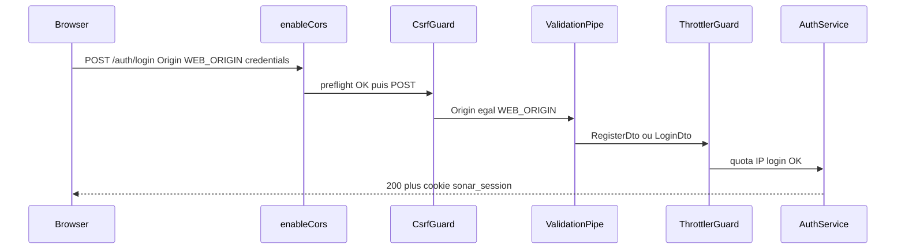

# Auth V1 : DTO, throttle login, CORS strict

Section 1 (DTO) **déjà livrée** sur `main` (`b5c2a60`). Exécuter seulement **§2 throttle** puis **§3 CORS**. Hors scope : LBB, front, CRM, `POST /sirene/:siret/create`.

Sources : NestJS ValidationPipe / CORS ([docs.nestjs.com](https://docs.nestjs.com)), `@nestjs/throttler` actuel (`ThrottlerModule.forRoot`, `seconds()`, `@Throttle` / `@SkipThrottle`). `class-validator` et `class-transformer` sont déjà dans [apps/api/package.json](apps/api/package.json). Le pipe global existe déjà dans [apps/api/src/main.ts](apps/api/src/main.ts).



---

## 1. DTO register / login — FAIT

Ne pas réimplémenter. Fichiers : `apps/api/src/auth/dto/`. Email trim+lowercase, password `@IsString` `@IsNotEmpty` (pas de MinLength 12 dans le code livré). 72 octets restent dans `PasswordService`.

---

## 2. Throttle login

**Pourquoi.** Register/login sont publics. Sans quota, le dummy bcrypt (~250 ms) ne suffit pas contre le stuffing. Le TODO dit **throttle login** seulement : ne pas limiter `GET /health`, `GET /auth/me`, ni Sirene.

**Dépendance.** Ajouter `@nestjs/throttler` dans le workspace `api` (Nest 12, API `ThrottlerModule.forRoot` + helper `seconds()`).

**Config.** Importer le module dans [auth.module.ts](apps/api/src/auth/auth.module.ts) (pas un `APP_GUARD` global) :

- un throttler nommé `login` : **5 requêtes / 60 s / IP** (storage mémoire V1, un process Nest)
- sur `POST /auth/login` uniquement : `@UseGuards(ThrottlerGuard)` + `@Throttle({ login: { limit: 5, ttl: seconds(60) } })`
- **ne pas** throttle `register` dans cette passe

CSRF global tourne **avant**. Réponse **429**. Pas de Redis. Tracker = IP par défaut.

**Tests.** 5 POST login (même IP, mock AuthService) → 6e = 429. Mini app Nest (ValidationPipe + Throttler + Origin CSRF). Pas d’e2e Postgres.

---

## 3. CORS sans fallback localhost

Aujourd’hui dans [main.ts](apps/api/src/main.ts) : `origin: process.env.WEB_ORIGIN ?? 'http://localhost:3000'`.

```ts
const config = app.get(ConfigService);
app.enableCors({
  origin: config.getOrThrow<string>("WEB_ORIGIN"),
  credentials: true,
  methods: ["GET", "HEAD", "PUT", "PATCH", "POST", "DELETE", "OPTIONS"],
  allowedHeaders: ["Content-Type", "Authorization"],
});
```

Extraire `buildCorsOptions(webOrigin: string)` dans [apps/api/src/config/cors.options.ts](apps/api/src/config/cors.options.ts). CORS ≠ CSRF : les deux restent.

---

## 4. Docs TODO

Dans [PROJECT_CONTEXT_AND_TODO.md](PROJECT_CONTEXT_AND_TODO.md) : cocher throttle + CORS ; corriger « Prochain code : bloc A ». Isolation CRM et Sirene public = hors chantier.

---

## 5. Vérification

- `npm test -w api`
- `npx tsc --noEmit -p apps/api`
- `npm run lint -w api`

Pas de commit sauf demande explicite.
